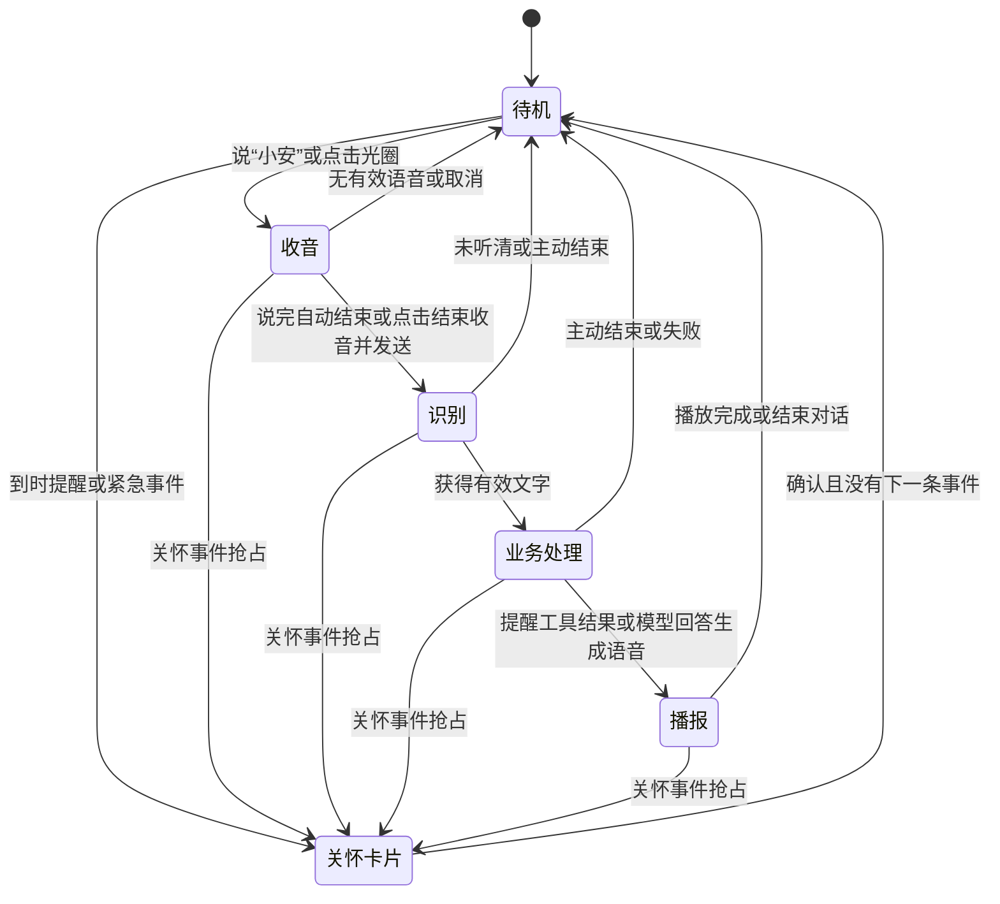
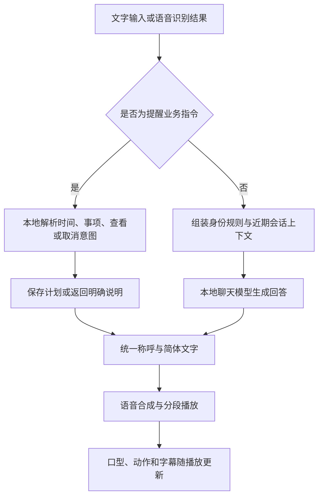
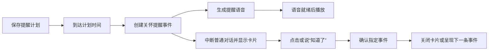

# 小安数字人 UI 界面设计与交互逻辑说明

版本：V1.0
整理日期：2026 年 10 月 24 日
项目：本地适老数字人陪伴系统
文档依据：当前 Unity 界面代码、网关业务代码、项目配置及已有实机验收材料。

> 本文描述当前已实现的界面与行为，可用于产品说明、设计交接、开发维护和功能验收。尺寸与字号均以 1600 × 900 的 Unity UI 参考画布为准，实际显示随窗口缩放。历史验收图用于辅助理解，局部文案与当前版本可能不同。

## 1. 产品定位与使用对象

小安面向老年用户提供日常陪伴、语音问答、备忘提醒和本地关怀提示。主界面优先呈现数字人、时间、当前交互状态和正在播报的文字，将角色、音色、文字输入等低频操作放入设置抽屉。

当前使用者选择的称呼为“爷爷”。小安是陪伴助手，当前仅保留男性小安形象，不改变用户的身份。系统支持“您、爷爷、奶奶”三种称呼，使用者可独立切换。

主要设计目标：

- 看得清：大字号、高对比字幕、简明状态和大按钮。
- 易开始：说“小安”或点击语音光圈即可开始。
- 有反馈：用提示音、状态文字、光圈和动作说明系统正在做什么。
- 可停止：收音可手动结束并发送，思考或播报可结束对话。
- 结果可信：提醒只有保存成功才确认，异常需显示可理解的提示。

## 2. 界面结构

### 2.1 主界面布局

```text
┌──────────────────────────────────────────────────────────────┐
│                                                   [设置]     │
│                                      ┌────────────────────┐  │
│                                      │ 今天 · 与您相伴    │  │
│                  数字人              │       13:55        │  │
│                                      │ 10月24日 星期六    │  │
│   语音光圈                           └────────────────────┘  │
│   待机 / 在听 / 在想 / 在说话                                │
│   唤醒提示                                                   │
│   [结束收音并发送 / 结束对话]（交互时出现）                    │
│ ┌──────────────────────────────────────────────────────────┐ │
│ │            与当前语音进度对应的两行大字幕                 │ │
│ └──────────────────────────────────────────────────────────┘ │
└──────────────────────────────────────────────────────────────┘
```

数字人显示在中部，语音状态位于左侧，大时钟位于右上方，字幕位于底部。启动默认视角为近景；若此前保存了全身模式，则恢复全身。设置抽屉默认关闭。

| 区域 | 主要内容 | 行为 |
| --- | --- | --- |
| 数字人展示区 | 男性小安角色、口型、眨眼、手势和投影 | 随对话播放动作；支持近景和全身 |
| 设置入口 | 右上角“设置”按钮 | 打开或关闭设置抽屉 |
| 时钟卡片 | “今天 · 与您相伴”、时分、中文日期和星期 | 按设备本地时间更新 |
| 语音交互区 | 光圈、状态、提示文字 | 光圈可点击；交互期间出现结束按钮 |
| 底部字幕区 | 当前播报内容或状态提示 | 播报时按语音进度翻页，提醒弹出时隐藏 |
| 提醒层 | 遮罩、卡片、提示和确认按钮 | 处理提醒与紧急事件 |

### 2.2 视觉规范

| 项目 | 当前规范 |
| --- | --- |
| 技术与适配 | Unity UGUI；参考画布 1600 × 900；Scale With Screen Size，Expand |
| 界面气质 | 浅色背景、深青绿主色、圆角卡片、较大的留白 |
| 正文深色 | `#1D3534` |
| 主操作青绿 | `#1C675F` |
| 次级按钮底色 | `#E1ECE8` |
| 已选按钮底色 | `#C6E4DA` |
| 设置卡片底色 | `#F2F7F6` |
| 时钟底色 | `#183E3B` |
| 字幕底色 | `#182C2E` |
| 紧急强调色 | 标识底色 `#A8362B`，标题 `#962A22` |
| 字号 | 时钟 72；主字幕 44；提醒标题 44、正文 40；主状态 38；设置标题 32 |
| 控件尺寸 | 设置内常用按钮高 50；提醒确认按钮 530 × 80；语音光圈 230 × 230 |
| 字体与文字 | 项目中文字体；面向用户的主要文字为简体中文 |

设置抽屉宽 440、高 824，与右侧、顶部各留 24 个参考单位。底部字幕容器为 1552 × 148。提醒卡片为 1100 × 610，向画面下方偏移，以尽量保留上方时钟。

这些尺寸记录当前实现，不代表已完成所有屏幕比例、视力条件和触控设备的适老性认证。

## 3. 设置抽屉设计

抽屉标题为“设置与更多”，副标题为“音量、形象与文字输入”。打开时出现半透明遮罩，点击“关闭”或抽屉外遮罩可关闭；关闭时结束拼音组合并取消输入焦点。

从上到下的功能如下：

| 功能组 | 控件 | 交互规则 |
| --- | --- | --- |
| 形象 | 刷新形象 | 当前仅保留男性小安；刷新要求角色已就绪 |
| 角色状态 | 当前陪伴、加载状态或失败原因 | 显示“正在加载角色…”或“切换失败：…” |
| 回答查看 | 可滚动的回答区域 | 显示当前完整回答；内容更新时滚动到末尾 |
| 文字输入 | 输入框、拼音候选 | 接收中文、拼音和粘贴；输入上限 1000 字符 |
| 输入操作 | 文字输入、粘贴、重播、麦克风、发送 | 根据录音与忙碌状态启用 |
| 处理状态 | 就绪、录音、识别、准备播放、正在回答等 | 帮助判断操作是否已被接收 |
| 音色 | 录入我的音色、恢复默认音色、当前音色 | 录入时按钮变为“停止并分析音色” |
| 视角 | 全身、当前近景 | 选中项高亮；调整相机并保存选择 |
| 辅助开关 | 大音量、唤醒监听 | 显示开启或关闭状态，并在本机保存 |
| 用户称呼 | 对您的称呼 | 按“您 → 爷爷 → 奶奶 → 您”循环；保存成功后更新 |
| 署名 | 当前模型资源署名信息 | 由角色加载器提供 |

### 3.1 中文输入

应用内提供拼音组合和候选，不依赖额外弹出的中文输入窗口。

1. 输入拼音后，在抽屉内显示候选，每页三个。
2. 按空格、回车或数字 1～3 选择候选，也可点击候选。
3. 使用候选翻页按钮或 PageUp / PageDown 翻页。
4. 有拼音组合时，回车先选字；组合清空后，再按回车发送。
5. 无拼音组合时，点击发送图标也可提交。
6. 粘贴支持按钮及 Ctrl / Command + V；文本通过本地接口统一简体。
7. 清除拼音组合可按 Escape；关闭抽屉也会清理组合。

### 3.2 按钮启用条件

| 场景 | 当前限制 |
| --- | --- |
| 普通对话处理中 | 输入框、发送、文字输入、粘贴、普通录音等操作禁用，避免重复提交 |
| 录音中 | 文字发送和重播禁用；停止收音通过光圈或主界面结束按钮完成 |
| 音色录入中 | 音色按钮可停止录入；普通对话录音禁用 |
| 无可用播放音频 | 重播按钮禁用 |
| 称呼正在保存 | 称呼按钮暂时禁用，并显示“正在保存称呼…” |
| 提醒卡片出现 | 设置抽屉隐藏，主界面优先处理提醒 |

角色切换主要受角色加载状态约束，音量与监听开关不属于普通输入控件的同一组忙碌限制。

## 4. 语音交互状态与流程

### 4.1 状态反馈

| 状态 | 主界面状态文字 | 界面反馈与可执行操作 |
| --- | --- | --- |
| 待机 | 待机 | 显示“叫一声‘小安’，我就在”；可说唤醒词或点击光圈 |
| 收音 | 在听 | 光圈响应输入声音；字幕提示说完稍等会自动发送；按钮为“结束收音并发送” |
| 识别及生成 | 在想 | 显示识别或分析提示；按钮为“结束对话” |
| 语音播放 | 在说话 | 光圈响应输出音量；字幕跟随语音；按钮为“结束对话” |
| 无有效语音 | 返回待机 | 提示“没有收到语音，请再叫我一次”等 |
| 唤醒服务连接异常 | 按当前业务状态显示 | 提示“唤醒连接中 · 可点击麦克风”或暂不可用 |
| 主动结束 | 返回待机 | 提示“已结束对话 · 想说话时再叫我” |

主状态按“正在收音 → 正在播放 → 正在处理 → 待机”的顺序判断。文字提示与光圈同时呈现，不仅依赖颜色表达状态。

### 4.2 语音对话状态图



语音唤醒后有柔和提示音和回应动作。离线自动收音按人声活动及静音判断结束，常规静音阈值约 0.7 秒，最长收音约 15 秒；这不等于判断一句话的语义是否完整。

光圈采用同一个入口：待机时开始收音；收音时结束并发送；思考或播报时结束当前对话。普通语音播放期间抑制后台唤醒，避免扬声器声音触发自身；尚未提供播放中的自由语音打断。

### 4.3 文字对话流程

打开设置 → 输入或粘贴文字 → 选字完成 → 点击发送或回车 → 显示处理状态 → 分段生成语音并播放 → 播放结束恢复就绪。

语音识别后的普通文本进入相同的聊天业务流程。求助或确认命令先由关怀逻辑处理，避免再次送入普通聊天。

## 5. 回答、语音与字幕逻辑

### 5.1 回答路径



当前对话模型为本地 Qwen2.5 3B Instruct，语音合成为 GPT-SoVITS。模型选择属于实现层，对用户表现为小安的统一身份。

### 5.2 身份与语言规则

- 用户是长辈，小安是陪伴助手；“爷爷”与角色性别分别设置。
- 使用已保存称呼，禁止直接以“好孩子、宝宝”等幼儿称呼叫用户。
- 清理历史消息中的错误直接称呼，避免错误在后续回复中延续。
- 回答先回应当前问题，使用简体中文和常用词。
- 未执行提醒工具，不得声称已经设置或取消。
- 不声称能端茶、拿药或已经联系家属、医生。
- 用药问题提示核对医嘱，区分重复服同一剂与下一次正常服药。

这些规则与输出修正用于减少错误，不代表聊天模型所有事实与推理均已可靠。

### 5.3 字幕与重播

主界面底部显示当前播放语音对应的文字，按两行页面展示。段与段的边界绑定实际音频时长，段内按播放进度和文字、标点权重估算翻页，没有逐字强制对齐。

流式回答后续文字即使已经生成，也不应提前替换当前正在播报的字幕。设置抽屉中的回答区仍显示完整文本，便于回看本轮内容。该区域不是永久保存的完整聊天记录页。

重播使用当前可重播的回答音频及其字幕时间线。开始新唤醒、主动中断或提醒抢占时清理当前字幕跟踪，避免旧内容继续显示。播放完成后保留已播页面。

## 6. 备忘提醒设计

### 6.1 可用表达

| 意图 | 示例 |
| --- | --- |
| 相对时间 | “一分钟后提醒我喝水”“十分钟以后提醒我关火” |
| 时间在后 | “小安，请提醒我一分钟后喝水” |
| 今天某时 | “今天12点52的时候提醒我吃药” |
| 明天、后天 | “明天下午三点半提醒我喝水”“后天上午八点一刻提醒我散步” |
| 每天重复 | “每天上午八点提醒我吃药” |
| 查看计划 | “查看提醒” |
| 取消指定任务 | “取消喝水提醒”；同名多条时按编号取消 |
| 取消指定编号 | “取消提醒”加设置结果中的八位编号 |
| 取消所有自定义计划 | “取消全部提醒” |

“一分钟后”就是明确时间，不需要用户换算为钟点。解析支持“后、以后、之后”，并从称呼、礼貌词之后找到实际时间表达。

### 6.2 设置规则

1. 收到请求后先本地解析，不交给模型猜测是否保存成功。
2. 校验时间和事项，写入数据库后，才返回“已设置提醒”。
3. 确认内容包含实际日期或每天重复规则、时分、事项和八位编号。
4. 显式“今天”的时间已经过去时，不设置，也不擅自改成明天。
5. 只有钟点而没有日期时，若该钟点已过，安排到明天，并在确认中写出实际日期。
6. 缺少时间、缺少事项、多时间或不支持的重复规则，要求用户明确说明。
7. 当前支持今天、明天、后天、每天，以及分钟或小时后的相对时间；不支持每周、每月等复杂重复。
8. 修改时间需要先取消原计划，再重新设置。
9. 同一事项、相同到期时间和重复规则的计划进行去重；用户再次提出相对时间请求时，可能因到期时间不同而形成新计划。

### 6.3 到时提醒流程



提醒卡片包括：青绿色图标、标题“备忘提醒”、提醒正文、确认说明和“知道了”按钮。用药事项附带核对药盒和医嘱、避免重复服药的提示。

提醒计划持久保存。设备和网关需保持运行才能按时提示；恢复运行时，超过两分钟的过期自定义提醒不再补发，每天的计划继续安排下一次。取消计划针对未来执行，已出现的卡片仍需单独确认关闭。

通过聊天取消的是自定义提醒计划。预设的午餐、晚餐和整点关怀来自配置，不属于“取消全部提醒”的同一组计划。

## 7. 关怀与紧急求助

### 7.1 优先级

| 事件 | 优先级 | 表现 |
| --- | --- | --- |
| 紧急求助 | 100 | 红色强调、感叹号、本地提示音、求助卡片；优先呈现 |
| 备忘及预设提醒 | 80 | 青绿色提醒卡片、文字与语音 |
| 整点关怀 | 70 | 报时及日常关怀提示 |

当前预设包含 08:00～21:00 的整点关怀，以及 12:00、18:30 的就餐与遵医嘱用药提醒。时间与内容由配置文件管理。

### 7.2 提醒出现时的界面变化

- 立即中断普通聊天协程与普通播放，防止后续旧音频重新抢占。
- 显示背景遮罩和大卡片，隐藏设置抽屉、底部普通字幕和语音光圈区域。
- 时钟仍保留在背景中。
- 语音未就绪时卡片先显示；语音失败也保留文字。
- 确认只作用于对应事件，避免录音期间出现的新事件被误关。
- 同时有多条事件时，按优先级依次呈现。

普通事件约 30 分钟过期，紧急事件约 24 小时过期。关闭或过期后重新根据当前事件列表决定界面。

### 7.3 紧急求助与外部推送

系统识别“救命、跌倒、摔倒、胸口疼、胸痛”等求助表达后进入紧急关怀流程。紧急事件先播放本地提示音，再等待合成语音；求助与普通确认同时出现时优先处理求助。

当前未配置照护端地址，因此界面显示“本地告警 · 尚未配置照护端”。配置后区分“正在推送”“推送失败，正在重试”“求助已推送至照护端”。推送成功只表示接收接口已接收，不表示家属已经阅读。系统目前没有自动拨打电话或硬件跌倒检测功能。

## 8. 数字人视觉反馈

| 场景 | 当前表现 |
| --- | --- |
| 待机 | 呼吸、自然眨眼和间歇眯眼笑 |
| 唤醒 | 柔和提示音和右手挥手回应 |
| 问候播报 | 首轮符合问候条件时触发挥手，避免同轮重复 |
| 普通播报 | 口型随音频、配合点头与已有手势 |
| 开心、感谢、陪伴等语句 | 根据本地词句规则触发短暂笑眼 |
| 疼痛、难过、求助等严肃语句 | 抑制笑眼和不适宜的开心表情 |
| 收音、思考、音色录入、关怀 | 暂停常规笑眼触发 |
| 中断或切换角色 | 清理原有交互表情状态 |
| 全身视角 | 地面显示柔和投影，增强角色落地感 |

笑眼目标为眼部表情完全闭合，呈细弯线，不停在半眯状态。表情采用渐入渐出，因此转换过程会经过中间状态。当前情绪触发依赖本地词句规则，不是独立情绪理解模型。

## 9. 音色与辅助设置

### 9.1 音色录入

点击“录入我的音色”后，界面显示朗读提示，建议自然录制约 5～10 秒；再次点击“停止并分析音色”后上传分析，完成后更新音色名称。“恢复默认音色”用于切回默认参考音色。录入期间避免普通录音与聊天操作争用麦克风。

### 9.2 音量

“大音量”提供约 +6 dB 的增益并保存选择，输出经过限幅。紧急提示自动使用增强增益。软件增益不能保证实际房间里的听感，仍需根据扬声器、距离及用户听力调节系统音量。

### 9.3 唤醒监听

开关控制后台关键词监听，关闭后提示“监听已关闭 · 可在设置中开启”。点击光圈的手动入口仍可用。正常情况下由离线服务统一持有麦克风；服务不可用时，客户端存在手动录音和关怀监听的回退路径。

## 10. 异常与恢复设计

| 异常 | 当前反馈或处理 |
| --- | --- |
| 启动资源尚未就绪 | 白色启动遮罩，当前文案为“Loading...” |
| 角色加载失败 | 设置内显示“切换失败”及原因 |
| 称呼加载或保存失败 | 显示可点击重试的提示；未保存成功不替换当前称呼 |
| 唤醒连接断开 | 显示连接提示并重连；可尝试手动麦克风入口 |
| 没有听清或无有效语音 | 返回待机，提示再次唤醒 |
| 模型异常、回答重复或语音失败 | 通过回答或状态区域提示失败，结束当前处理 |
| 音频设备未开始播放 | 提示检查系统声音并重播 |
| 关怀服务断连 | 自动重试连接，保留当前已显示内容 |
| 提醒语音失败 | 卡片提示查看文字，不因语音失败隐藏提醒 |
| 确认请求失败 | 显示“确认未送达，请重试” |
| 外部求助推送失败 | 显示重试状态；本地卡片继续可见 |

部分连接提示仅在相关区域可见，尚未形成独立、统一的全局连接状态面板。

## 11. 数据保存与时间规则

| 数据 | 保存方式或当前行为 |
| --- | --- |
| 用户称呼 | 网关配置持久化，当前为“爷爷” |
| 全身或近景选择 | 客户端 PlayerPrefs |
| 大音量与唤醒监听开关 | 客户端 PlayerPrefs |
| 自定义提醒、事件和确认状态 | SQLite 数据库 |
| 预设关怀时间 | 配置文件 |
| 当前音色 | 音色配置及参考音频 |
| 普通聊天上下文 | 客户端内存中保留近期轮次；当前最多四轮，不是永久聊天档案 |
| 时钟 | 客户端设备本地时间 |
| 提醒调度 | 配置时区 Asia/Shanghai |

部署时应保持设备本地时区与提醒时区一致，否则时钟显示和提醒确认时间可能不一致。当前设置页没有独立的时区选择、提醒管理列表页或永久聊天记录页；查看、取消自定义提醒通过对话完成。

## 12. 功能验收清单

| 验收场景 | 预期结果 |
| --- | --- |
| 启动 | 资源准备期间有遮罩，完成后显示数字人和主界面 |
| 打开与关闭设置 | 按钮与遮罩可关闭，关闭后清理输入组合 |
| 拼音输入 | 候选可选择；首次回车选字，组合清空后回车发送 |
| 一轮语音对话 | 待机 → 在听 → 在想 → 在说话 → 待机，反馈连贯 |
| 手动结束收音 | 提交已有语音，不继续收音 |
| 结束对话 | 当前处理或播报停止，旧回答不继续恢复播放 |
| 两行字幕 | 跟随当前语音页面，不提前显示回答结尾 |
| “一分钟后提醒我喝水” | 实际保存一分钟后的计划，并给出确认 |
| “小安，请提醒我一分钟以后喝水” | 正确解析称呼、礼貌词和后置时间 |
| 今天的时间已过 | 明确说明未设置，不自动改成明天 |
| 查看与取消 | 能查询计划；指定编号可取消对应计划 |
| 到时提醒 | 出现卡片并在语音就绪后播放；可确认关闭 |
| 提醒抢占 | 普通对话停止，设置和普通字幕隐藏 |
| 紧急求助 | 红色卡片及本地提示音；推送状态符合实际配置 |
| 用户称呼 | 按保存值称呼，形象不改变用户称呼 |
| 笑眼与投影 | 两个角色笑眼达到细线闭合，全身视角可见落地阴影 |
| 重启 | 保存的偏好与计划恢复，过期提醒按规则处理 |

## 13. 维护入口与参考材料

| 内容 | 对应实现 |
| --- | --- |
| 设置抽屉与输入控件 | `unity-patches/AvatarPipeline/LocalHumanPanel.cs`、`ChineseInputField.cs` |
| 主界面、时钟、关怀卡片 | `unity-patches/AvatarPipeline/SeniorCareClient.cs` |
| 唤醒、手动结束和中断 | `unity-patches/AvatarPipeline/OfflineWakeClient.cs` |
| 对话、录音、音色与播放 | `unity-patches/LocalHumanDemo.cs` |
| 字幕 | `unity-patches/AvatarPipeline/SpeechSubtitleTrack.cs` |
| 称呼、视角 | `SeniorCompanion.cs`、`AvatarViewMode.cs` |
| 表情与动作 | `unity-patches/VrmPipeline/AvatarInteractiveMotion.cs` |
| 网关聊天、身份与提醒 | `gateway/app.py`、`gateway/companion.py`、`gateway/reminders.py`、`gateway/care.py` |
| 配置 | `config/companion.json`、`config/care.json`、音色配置 |

相关说明：[关怀与提醒](../gateway/SENIOR_CARE.md)、[离线唤醒](../gateway/WAKE.md)、[语音流程](../gateway/VOICE_PIPELINE.md)。

已有验收材料：

- [主界面待机截图](../artifacts/validation/offline-wake/standby.png)
- [设置抽屉截图](../artifacts/validation/offline-wake/settings.png)
- [应用内中文输入截图](../artifacts/validation/chinese-input/input.png)
- [男性角色地面阴影](../artifacts/validation/interactive-motion/man-ground-shadow.png)
- [实机提醒卡片截图](../artifacts/validation/companion-logic/reminder-live.png)
- [一分钟提醒修复验收](../artifacts/validation/companion-logic/one-minute-fix.json)

提醒卡片实机截图包含桌面背景，公开分享前应裁剪应用区域。以上链接为项目本地材料，分享文档时需要同时携带对应文件。

## 新增：中文输出与只听本人声音（2026-10-24）

设置抽屉底部新增两个按钮：“录入识别声音”和“只听我：先录入／开启／关闭”。请用户单独自然说话五到十秒，再点击“停止并保存声音”；十秒自动停止。成功后自动开启，只接收与该声音匹配的普通对话。失败时在回答区域显示中文原因并保留旧档案。

“录入我的音色”控制数字人回答的声音；“录入识别声音”控制谁可以通过语音输入普通指令。两者独立，按钮不能交叉提交。录制期间禁止文字提交、切换限制和另一种录入，界面明确显示当前录入种类。

输入处理：降噪 → 人声检测 → 已开启时核对声纹 → 转写 → 低可信度过滤 → 指令或对话。无清晰人声或声纹不匹配时，显示中文提示并要求重说，不提交新对话。紧急求助关键词保留。输出处理：模型生成 → 中文检查与必要的中文改写 → 屏幕文字与语音合成。

声纹功能需要本人首次录入；初始状态为关闭。此功能不能保证在多人同时说话时分离本人声音，应提示靠近麦克风单独重说。

## 新增：城市定位与天气卡片（2026-10-24）

主界面时钟卡片下方增加天气卡片，显示城市、定位方式、当前天气与温度、今日高低温、最高降水概率及数据时间。卡片沿用浅绿色圆角样式，点击卡片刷新；下方“重新定位”按钮重新估算城市，并提示可输入“定位到杭州”进行修正。

首次查询自动通过网络出口估算城市，显示“网络估算”；输入“定位到杭州市”后显示“已选城市”。这不是街道级定位或 GPS 跟踪。“我现在在哪里”说明当前设置的来源；“上海明天天气”临时查询其他城市，不修改所选城市。

对话中的天气查询由工具直接返回中文结果，同时用于字幕和语音，不依赖模型记忆。支持当前、今天、明天和后天。界面三十秒读取一次，服务端天气缓存十分钟；刷新失败时显示失败提示，最多使用一小时内、日期匹配的旧数据并标记。紧急提醒弹出时天气卡片隐藏，避免遮挡提醒内容。详细接口与数据约束参见 `gateway/WEATHER.md`。

### 天气卡片精简

按最新界面要求，移除天气卡片下方的“重新定位”按钮及整个按钮框，移除卡片内“开放气象”与数据时间一行。天气卡片收紧高度，仅显示城市、天气温度和今日高低温及降水概率，点击卡片仍可刷新。手动修改城市可通过对话输入“定位到杭州”。更新失败时显示失败提示，使用旧数据时作简短标记。

### 2026-10-24 连续对话交互

当前客户端保留最近六轮成功对话，供小安理解连续表达。天气支持“杭州今天天气”
之后直接说“那明天呢”“上海呢”“要带伞吗”；定位设置成功后可说“换成宁波”。
城市同音歧义时，可直接回复候选城市名。提醒可分轮补充缺少的时间或事项，设置成功后
可说“改成两分钟后”“取消这个提醒”。修改成功后替换原提醒，不产生重复任务。
缺少明确上下文、提醒已失效或切换话题后不确定指代时，小安会询问具体对象。
此处历史用于当前会话，重新启动客户端后清空；已保存的城市和提醒独立持久化。

### 2026-10-24 提醒精简与语音识别升级

提醒设置/修改成功后仅确认时间和事项，不显示或播报内部编号；查看提醒也不再列出
内部编号。可直接说“修改刚才的提醒”“取消这个提醒”，或查看后说“取消第一个提醒”。
上下文引用仍会核对已保存记录，无法唯一确定时询问。
主语音识别升级为 SenseVoice-Small，优先使用显卡，显卡不可用时使用 CPU。
原录音、唤醒、只听我和聊天界面操作保持一致。配置和部署说明见 gateway/ASR.md。


## 当前形象调整（2026-10-24）

已移除女性形象、性别选择按钮及女性模型的运行时加载与预热。设置保留全宽“刷新形象”按钮，状态显示“当前陪伴：小安”。客户端安装包只包含男性模型和男性档案，默认启动男性角色。
