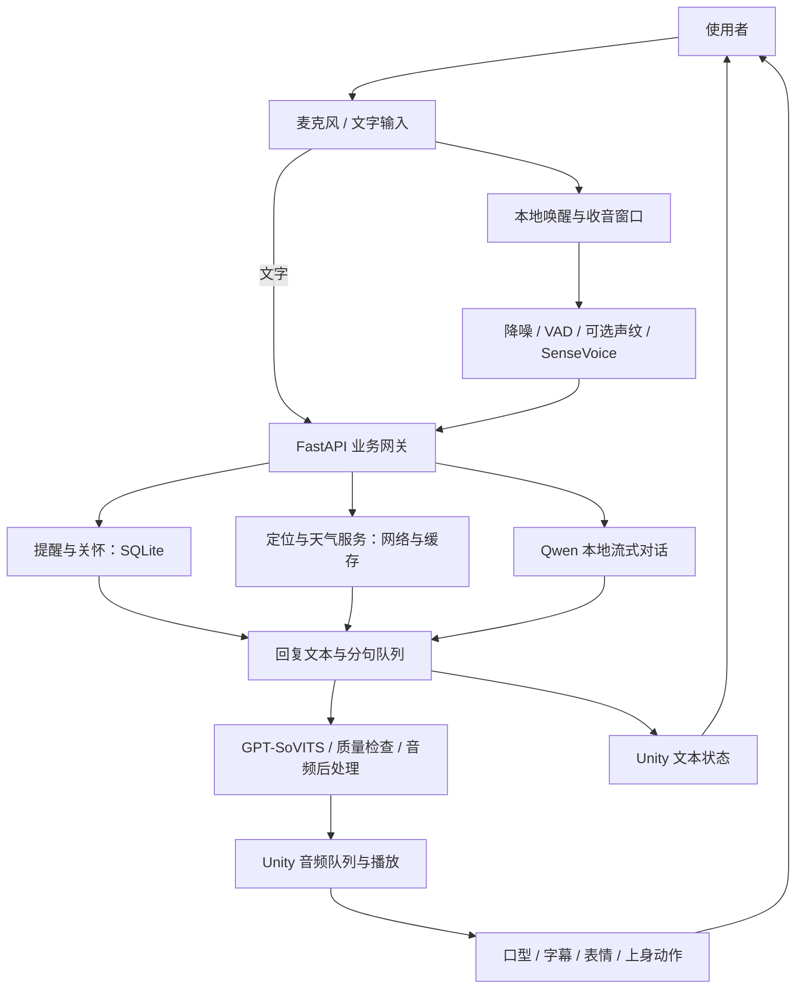

# 小安数字人项目：从 0 到 1 的技术落地介绍

版本日期：2026 年 10 月 24 日。本文依据当前开发工作区的源码、服务配置和验收记录编写，适用于项目汇报、技术答辩与研发交接。本文的“实施阶段”按技术依赖重新组织，方便说明如何从零构建系统，不代表历史开发工期。已有测试结果均引用历史记录，本次文档整理未重新运行模型或完整验收。

## 一、项目定位：让数字人成为可以持续交互的陪伴终端

小安是一套面向老年陪伴场景的本地数字人系统。使用者可以通过“小安”唤醒、语音或文字进行交流，系统完成语音识别、意图判断、对话生成和语音合成，再由 Unity 三维角色通过口型、表情、动作和字幕呈现回复。

项目围绕日常使用形成完整功能闭环：闲聊陪伴、自然语言设置提醒、天气查询、主动关怀和本地求助提示。当前客户端只保留男性形象，默认使用与形象匹配的少年男声方向参考音色，并允许录入新的参考音色。

从零落地时，需要同时解决三个问题：用户说的话如何可靠进入系统；涉及提醒、天气等实际功能时如何得到真实结果；系统的回复如何以自然、清楚、可中断的方式呈现给用户。

当前定位为单机陪伴终端。核心语音和对话模型在本地运行；天气、首次 IP 城市估算以及未来配置的照护端通知需要外部网络。模型首次下载与运行资源准备也需要单独完成。

## 二、总体架构：Unity 呈现、Python 编排、本地模型推理

系统分为交互呈现层、业务编排层、模型推理层和数据存储层。

| 层级 | 当前技术 | 主要职责 |
| --- | --- | --- |
| 交互呈现 | Unity 2022.3.31f1、URP 14、UniVRM 0.128.1、UGUI | 三维角色、界面、播放、字幕、表情、动作与用户操作 |
| 业务编排 | Python 3.10、FastAPI、HTTP、WebSocket | 输入校验、业务路由、会话任务、模型调用、取消与异常处理 |
| 离线唤醒 | Sherpa-ONNX、Zipformer 关键词模型、PulseAudio | 常驻监听唤醒词，管理唤醒后的录音窗口 |
| 语音输入 | FFmpeg、Silero VAD、SenseVoice-Small | 降噪、有效人声检测、中文转写与数字标点规范化 |
| 可选声纹核对 | CAMPPlus 中文声纹模型 | 核对普通语音输入是否与已录入用户匹配 |
| 对话生成 | llama.cpp、Qwen2.5-3B-Instruct、Q4_K_M | 本地中文聊天、上下文理解、流式生成 |
| 语音输出 | GPT-SoVITS v2、FFmpeg | 参考音色合成、质量检查、降噪和适老音频处理 |
| 数据与配置 | SQLite、JSON、本地文件与内存缓存 | 提醒、关怀事件、偏好、模型、参考音频及运行缓存 |
| 运行管理 | systemd 用户服务、Shell/Python 脚本 | 启停、故障重启、模型校验、构建与健康检查 |



本机服务接口按职责分开：LLM 服务监听 `127.0.0.1:8080`，TTS 服务监听 `127.0.0.1:9880`，业务网关监听 `127.0.0.1:9881`。Unity 主要与网关通信，由网关统一处理业务和模型调用。

## 三、核心交互链路：从叫醒小安到听见回答

### 1. 待机唤醒与收音

待机阶段由轻量关键词模型监听“小安”，检测到后通过 WebSocket 通知 Unity。客户端播放提示音、显示收音状态并触发问候动作，随后进入当前话语的录音窗口。

唤醒后采用人声检测和静音判断控制自动提交：说话后约 1.5 秒无人声时结束；约 5 秒没有有效语音则返回待机；单次录音上限为 15 秒。使用者也可以点击“结束收音并发送”主动提交。

收音结束后关闭该窗口，后续环境声音不再追加到已经提交的话语。待机语音不送入聊天模型。普通播放期间暂停关键词检测以减少自唤醒；当前没有声学回声消除，因此尚不具备稳定的边播边听能力。

### 2. 语音转文字与输入治理

音频先进行降噪、重采样、人声检测和可选声纹核对，再交给 SenseVoice-Small 识别。当前主识别优先使用 CUDA，失败时可回退 CPU；保留 Faster-Whisper 相关工具用于 VAD，主转写已切换至 SenseVoice。

转写结果经过标签清理、简体转换和受限语境纠错。例如在明确定位指令中将“订为到行舟”修正为“定位到杭州”；城市同音且存在多个候选时要求确认。提醒纠错保留原始时间、事项和否定语义。

SenseVoice 当前不支持原生声学热词偏置。项目中的热词配置服务于识别后的受限纠错。接口保留原始转写与纠正结果，便于定位识别和业务解析分别出现的问题。

### 3. 根据意图执行真实功能

识别文本进入业务网关后，先判断是否属于提醒、天气、位置或关怀等功能，再进入普通聊天。需要创建提醒时由解析器验证时间和事项并写入 SQLite；查询天气时调用真实天气服务并处理缓存；普通陪伴交流才由本地 Qwen 生成。

例如“一个小时后提醒我”缺少事项时，系统先追问；用户补充“提醒我吃饭”后，再依据当前会话上下文创建实际记录。只有保存成功后才回复设置成功。相对时间从补全信息、实际创建时开始计算。

### 4. 流式生成与分段语音

Unity 通过 `POST /api/chat/jobs` 创建任务，再轮询任务状态。网关持续接收 LLM 文字，将适当长度的句子加入 TTS 队列；文字生成与已完成句子的语音合成可以重叠执行。

客户端约每 150ms 获取进度，预取下一段音频，并通过统一 AudioSource 播放。完整任务结束后保留拼接音频及片段时间线供重播。当前流式分段设置最小长度，以避免过短称呼片段单独合成时出现无声。

这一设计缩短的是开始呈现和开始说话的等待时间。首文字、首段音频就绪、客户端实际开播与整段完成需要分别统计。当前聊天还有单次生成预算和整轮超时限制，并提供截断、失败和继续提示。

### 5. 播放驱动角色表现

uLipSync 分析实际播放的音频，将 A/I/U/E/O 五元音映射到 VRM 的 `aa/ih/ou/ee/oh` 表达式。自然眨眼、互动笑容和照片参数分别管理，避免相互覆盖。

字幕绑定正在播放的语音片段，按 AudioSource 播放进度分页，防止后续生成文字提前覆盖当前字幕。挥手、点头和讲话手势也在实际开播后触发。段内字幕和语义动作使用时间估算，尚未实现逐词强制对齐。

用户结束对话时，系统同时停止播放、清理字幕和动作，并取消对应聊天任务；取消后的迟到识别或生成结果不再触发新回复。

## 四、三维数字人如何实现自然表现

### 标准 VRM 资产接入

当前采用标准 VRM 角色与 UniVRM 运行时，使用角色自带的 Humanoid 骨架、材质、表达式和 SpringBone。当前产品固定男性形象，历史女性角色和切换功能不属于现版本交付。

渲染使用 Unity URP 与 MToon，配合纯白场景、柔和阴影和棚拍式灯光。站立通过稳定 Idle、足部 IK 和支撑面检测减少滑步与穿地，呼吸与原生 SpringBone 提供轻微待机运动。

### 动作与表情分层

上身动作使用 Animator 独立层和 AvatarMask，保留腿部、足部 IK 与基础呼吸。问候触发挥手，讲话按规则安排解释、强调或点头，结束后逐步回到待机。

笑眼、嘴角、眨眼和口型采用独立通道组合。疼痛、求助等严肃词句优先抑制笑容。当前动作与情绪判断以本地文本规则为主，复杂反话与否定仍需要改进。

### 照片参数工具的适用范围

项目保留 MediaPipe 478 点照片特征提取与档案导出工具，可以提供肤色、发色、笑意、眼部参数和参考纹理，再由 Unity 按角色可用能力映射。

照片参数能否改变脸型取决于目标 VRM 是否具有对应形状键、骨骼和 UV。当前方案属于现有角色的参数适配，尚不能由单张照片自动重建完整三维身份模型。

## 五、适老业务如何形成闭环

| 业务 | 落地方式 | 需要关注的边界 |
| --- | --- | --- |
| 日常陪伴 | 本地 Qwen、会话历史、简体守卫、称呼配置 | 小模型仍可能产生知识和推理错误 |
| 自然语言提醒 | 时间解析、上下文补全、SQLite 持久化、到时卡片与语音 | 设备需运行；不支持的时间规则要求重述 |
| 提醒管理 | 查询、修改、取消，按时间和事项定位记录 | 多条相似记录需明确目标 |
| 天气与城市 | IP 城市估算、手动定位、Open-Meteo、缓存回退 | 依赖联网；城市估算不提供 GPS 精度 |
| 主动关怀 | 定时调度、事件优先级、确认、去重和过期管理 | 用药内容提示遵医嘱，不承担用药决策 |
| 语音求助 | 关键词、紧急卡片、本地提示音、可配置 webhook | 不是传感器跌倒检测；外部照护端尚需联调 |
| 个性音色 | 5～10 秒参考录音、ASR 转写、试听成功后启用 | 参考音频克隆不涉及新模型训练，效果依赖录音质量 |
| “只听我” | 独立录入声纹、余弦相似度核对 | 尚不能可靠分离同时说话的多人声音 |

会话历史随当前请求传递，不作为全局共享记忆，也未实现长期个人记忆。提醒、关怀事件与偏好采用各自的持久化方式，重启后按规则恢复。

当前天气正常缓存为 10 分钟，失败时可以使用不到一小时且日期有效的旧数据，并明确标记。天气稳定性修复还加入持久缓存、坐标复用、有限重试及失败冷却，减少网络故障时反复请求。

紧急事件可以抢占普通对话，卡片和本地提示音优先出现。正在执行的单次 TTS 不会被强行终止，因此求助语音仍可能等待。未配置真实照护端地址时，系统只有本地告警能力。

## 六、从 0 到 1 的实施顺序与交付物

| 阶段 | 主要工作 | 阶段交付物 | 进入下一阶段的条件 |
| --- | --- | --- | --- |
| 1. 明确场景 | 确定陪伴对象、核心指令、硬件和联网范围 | 场景清单、功能边界、资源清单 | 每个功能有明确触发与成功结果 |
| 2. 建立推理环境 | 安装驱动、Python、Torch、FFmpeg、Unity；下载校验模型 | 可独立运行的 LLM、ASR、TTS | 三种模型均用真实输入跑通 |
| 3. 打通最小对话 | 文本输入→网关→LLM→TTS→客户端播放 | 第一条完整对话链路 | 文字、音频及错误状态均能返回 |
| 4. 接入标准角色 | 导入 VRM，接入口型、眨眼、Idle 与足部定位 | 可说话的三维客户端 | 真音频驱动口型，停播后能恢复 |
| 5. 加入语音交互 | 唤醒、VAD、ASR、自动收音结束、手动中断 | 无需键盘的交互闭环 | 唤醒、提交、取消和再次唤醒通过 |
| 6. 完成业务执行 | 提醒、天气、称呼、关怀与上下文补全 | 可持续使用的陪伴终端 | 工具结果真实、保存与恢复正确 |
| 7. 优化体验 | 分句合成、预取、参考音色、字幕与动作 | 更连贯的视听交互 | 声音、字幕和动作跟随同一播放片段 |
| 8. 加固并交付 | 超时、重试、质量检查、缓存、服务管理与文档 | 构建产物、配置、日志、验收报告 | 冷启动、失败恢复及现场场景通过 |

执行时先让每个模块可以独立验证，再逐层集成。例如先用一条真实音频验证 ASR，再验证“唤醒→收音→ASR”，最后才加入聊天和角色播放，便于判断故障属于哪一层。

## 七、语音质量与稳定性如何保障

参考音色录入先检查格式、时长和有效音量，自动转写并试合成，成功后原子替换配置；失败保留原音色。参考清理使用副本，降噪后裁剪外侧静音并保留人声两端余量，中间停顿继续保留。

语音输出增加 VAD 和中文转写覆盖检查，对无声或明显漏读进行有限重试，最终失败返回明确错误。输出再经过降噪、均衡、压缩、响度校正和限幅。当前适老语速参数为 `0.82`，分段增加尾部停顿；最终听感还需在实际扬声器上确认。

成功处理的重复语音片段进入进程内 LRU 缓存，容量为 32 条、总计 32MiB、有效期 10 分钟。缓存键包含文本、语言、音色配置与参考文件摘要，避免切换音色后复用错误语音。失败结果不写入缓存。

聊天任务提供整体超时、上游断流处理和重复生成保护；文字生成或语音合成失败时，取消相关异步任务，回收并发名额。Unity 音频片段结果使用独立数据结构，避免递归序列化影响播放。

目前采用单网关进程，关怀调度随其启动，模型推理与 TTS 也有相应串行保护。将 Uvicorn 简单扩为多个 worker 会涉及调度重复、状态隔离和 GPU 竞争，多终端部署需要另行设计任务队列和共享状态。

## 八、部署方案与环境准备

已验证的开发基线为 Ubuntu、Unity 2022.3.31f1、Python 3.10、Torch 2.6 / CUDA 12.4，以及 RTX 4060 Laptop GPU。当前 Qwen 3B 的服务配置使用 CPU 推理、8192 上下文；TTS 和 ASR 优先使用 CUDA，Unity 同时使用显卡渲染。

新机器需要准备匹配的显卡驱动、模型、VRM 角色、参考音频、语言资源和 Unity 依赖。显存、内存与磁盘应按实际模型驻留和并发负载评估；已验证配置不能直接推导最低硬件要求。代码包与完整运行环境应分别交付，公开源码快照未包含所有模型、角色和个人素材。

本机主要运维入口如下，迁移时需替换绝对路径、Python 环境和桌面 DISPLAY：

```bash
cd /home/yyy/digital-human
source deploy-env.sh

# 模型完整性检查
PYTHONPATH=. /home/yyy/miniforge3/envs/human-gsv-v2/bin/python scripts/download-sensevoice.py --offline

# 启动核心服务，查看网关与子模块状态
systemctl --user start human-llm human-tts human-gateway
curl -fsS http://127.0.0.1:9881/ready
curl -fsS http://127.0.0.1:9881/api/asr/status
curl -fsS http://127.0.0.1:9881/api/wake/status

# 构建与启动客户端
bash scripts/build-unity.sh
DISPLAY=:1 bash scripts/open-client.sh
```

Unity 侧以 `unity-patches/` 为自研源码与集成补丁入口，经脚本同步至 `human-code/` 后构建。部署时还需核对 systemd drop-in：当前 ASR 启动入口由用户服务覆盖配置接入 `scripts/start-gateway.sh`，只复制基础 service 文件不足以完整迁移。

交付资源包括代码、依赖版本、模型来源及校验值、授权角色和声音、配置模板、服务定义、构建脚本与验收说明。当前公开快照仍有原机器路径和历史测试素材依赖，尚未形成全新机器一键安装包。

## 九、如何验收“已经落地”

验收应同时覆盖功能正确性、真实模型链路、客户端呈现与现场体验。

1. **模块与业务回归。** 用隔离数据库和配置验证时间解析、提醒补全、取消、天气缓存、指令纠错、声纹拒绝、语音质量与任务取消。模拟故障适合验证断流和超时，不能充当真实模型效果证据。
2. **真实模型调用。** 用 WAV 验证 ASR，用固定文字验证 TTS，用真实聊天检查分段音频、错误状态与任务结束。提醒需要核对数据库时间和实际触发，天气需要核对数据日期与旧数据标记。
3. **Unity 集成。** 检查分段播放、重播、中断、字幕分页、口型、动作释放、足部定位、窗口适配和中文输入，保存构建与运行日志。
4. **现场使用。** 使用最终设备、目标使用者声音和实际房间环境，检查远场、轻声、方言、电视背景声、连续问答、断网和重启恢复。

已有材料记录了多个版本的真实 Unity 构建、模型调用和截图。以下数据用于说明验证方式，分别来自不同版本及场景，不能拼接为当前整机统一性能承诺。

| 已有记录 | 测量结果 | 适用范围 |
| --- | --- | --- |
| 缓存真实语音重播的历史渲染采样 | 多轮最大帧间隔约 17～18ms，无超过 33ms 帧 | 特定 1080p 窗口；不含模型加载、推理等待和 4K 读回 |
| 新参考音色清理后的真实流式聊天 | 首文字 4.580s、首音频 6.792s | 一次本机样本，首音频为服务端就绪 |
| 默认男声后续部署检查 | 四条真实 TTS 均出声，仍有转写措辞差异 | 有限样本，音色之后还有调整 |
| 重复片段语音缓存 | 同句约 1.089s 降至命中后约 2ms | 仅缓存命中接口，不适用于全新问题 |
| 本地提醒两轮补全联调 | 第二轮实际写入，约一小时后排期 | 验证数据库结果，临时记录已清理 |
| 天气稳定性验证 | 在线取数、重启恢复缓存、失败回退与并发缓存请求通过 | 不能保证公共天气服务始终可用 |

后续应持续采集端到端延迟的中位数和 95 分位，并拆分录音、ASR、路由、LLM、TTS、质量检查、下载与实际播放，区分冷启动、重试和缓存命中。

## 十、当前成果与后续落地方向

当前已形成可运行的本地数字人原型：语音唤醒与收音、中文识别与对话、分句语音、三维口型和动作、字幕、提醒、天气、主动关怀、音色录入和服务管理均有实现及验证材料。

下一步优先扩大真实用户录音样本，补充录入时的噪声、削波和有效人声质量反馈，并建立长期耗时与失败率统计。随后完善全新机器部署包、声音和角色资源清单，开展实际居家场景连续运行验证。

多用户长期记忆、独立知识库检索、逐词音画对齐、全双工语音与回声消除、照护端闭环以及多设备平台属于后续扩展，当前交付尚未覆盖。现有角色、声音及第三方工程需分别核对授权，公开代码不等同于完整资源均可用于商业发布。

## 十一、可直接用于汇报的介绍稿

小安是一套面向老年陪伴场景的本地三维数字人系统。项目从日常陪伴需求出发，逐步打通了语音唤醒、中文识别、意图判断、模型回答、语音合成和三维呈现的完整链路，并接入真实提醒、天气查询与主动关怀，让数字人能够在交流之外完成具体日常任务。

技术上，客户端使用 Unity 和标准 VRM 角色，负责界面、口型、表情、动作和字幕；后端使用 Python FastAPI 统一编排。语音输入通过 Sherpa-ONNX 唤醒、Silero 人声检测和 SenseVoice 识别，本地 Qwen 负责普通交流，GPT-SoVITS 负责参考音色合成。提醒等操作由业务模块校验并写入数据库，天气由真实接口提供数据，模型回复与功能执行之间有明确接口。

为改善交互等待，项目将模型流式文字按句送入语音队列，使文字生成和语音合成重叠执行，客户端预取后续音频。字幕、动作和口型跟随实际播放，用户也可以随时结束回答。针对老人使用习惯，系统提供自动结束收音、大字字幕、较缓语速、称呼设置和主动提醒。

工程落地方面，项目已经建立模型校验、systemd 服务管理、健康检查、失败重试、语音质量检测、缓存、任务取消以及自动化验收脚本。当前形成了可运行、可验证的单机陪伴原型，接下来的工作重点是更多真人与家庭环境验证、长期稳定性统计和部署标准化。

## 十二、技术交接参考

- 当前状态与历史证据：`../RESUME.md`。
- 网关与编排入口：`../gateway/app.py`。
- 主语音识别：`../gateway/ASR.md`、`../gateway/asr_service.py`。
- 唤醒与收音：`../gateway/WAKE.md`、`../gateway/wake_worker.py`。
- 语音任务与音色：`../gateway/VOICE_PIPELINE.md`。
- 提醒与上下文：`../gateway/reminders.py`、`../gateway/conversation_context.py`。
- 关怀事件与天气：`../gateway/SENIOR_CARE.md`、`../gateway/WEATHER.md`。
- 角色动作与表情：`../unity-patches/VrmAssets/INTERACTIVE_MOTION.md`。
- 界面设计与交互：`数字人UI界面设计与交互逻辑说明.md`。
- 构建及服务：`../scripts/build-unity.sh`、`../services/`。
- 真实运行验证材料：`../artifacts/validation/`。

部分模块文档保留旧版本过程说明，判断当前能力时应结合最新源码与 `RESUME.md` 后部更新，尤其注意识别模型、男性单形象和默认音色已经变更。
